# ExpenseTracker Pro

[](https://github.com/Abhi12Rathore/ExpenseTracker/actions/workflows/android-ci.yml)

An Android expense tracker that keeps your data on the phone, where adding a spend takes one sentence, one bill photo or one tap, in six languages and 24 currencies.

<p align="center">
  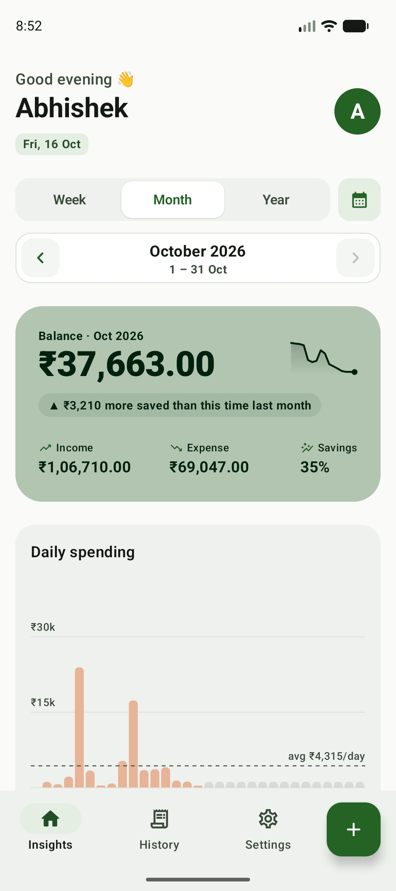
  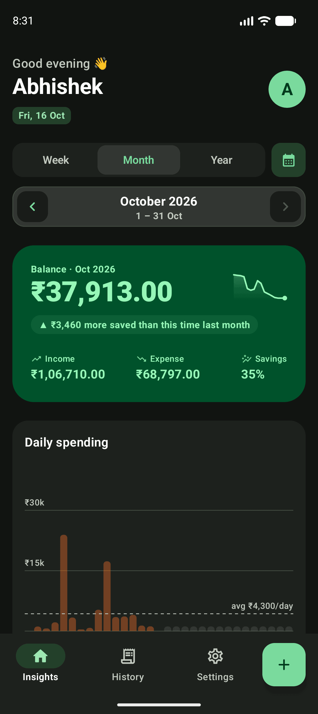
  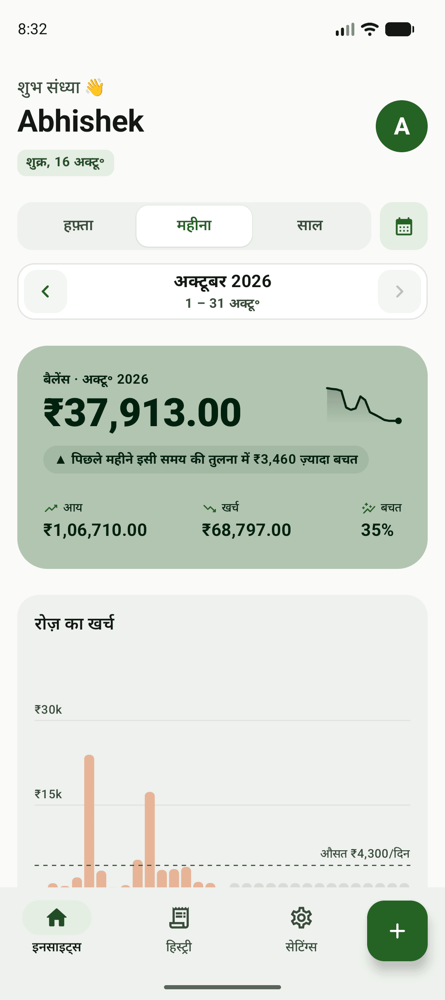
</p>

<p align="center">
  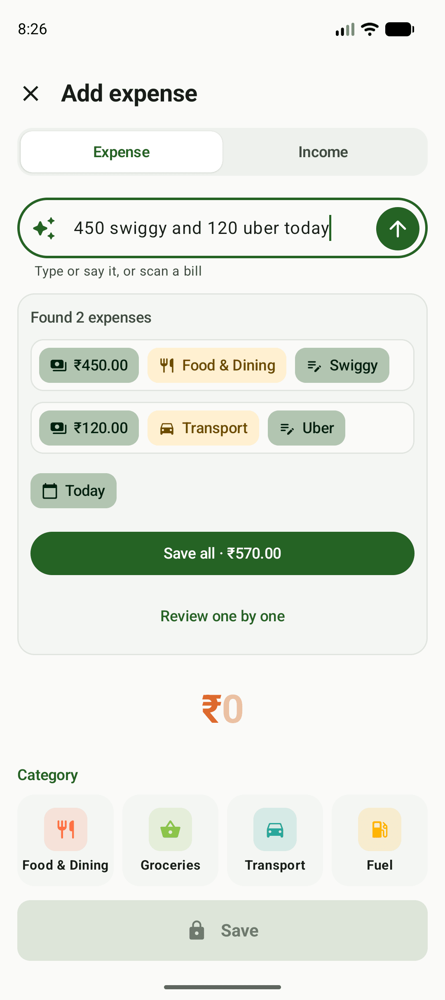
  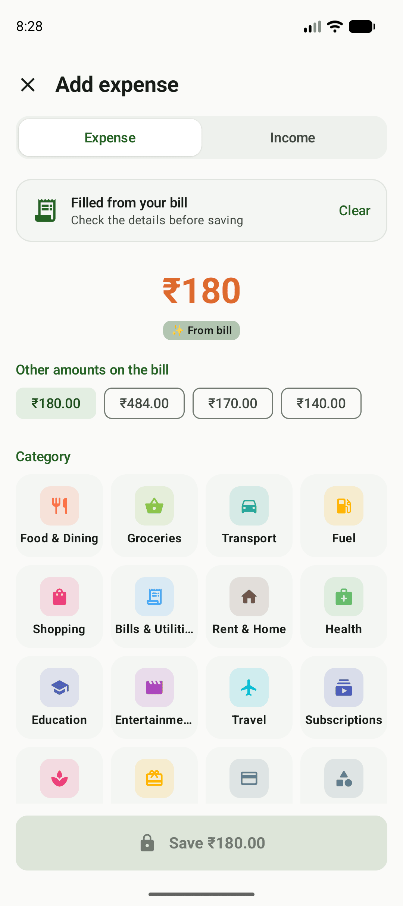
  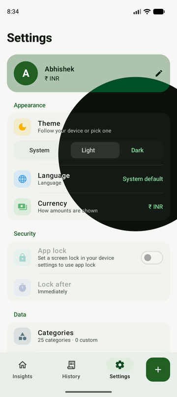
</p>

---

## Features

### Track
- **Transactions**: income and expenses with title, amount, category, date and note; add, edit, delete.
- **Custom categories**: add, edit and delete your own, with an icon, separately for income and expense. The 25 built-in ones follow the app's language.
- **Period filter**: Week, Month or Year, stepped with the arrows or a swipe, or a custom date range. Home and History use the same filter.
- **History search**: matches the title, the note and the category name, within the period.

### Add fast
- **Quick add**: type or say it ("450 swiggy and 120 uber today") and the app reads the amount, the title, the category, the date and the type. You see a preview and nothing is saved until you tap Save. The rules are plain Kotlin, with no model and no network, and read English and Hinglish.
  - **Several in one sentence**: saved all together (all or none), or reviewed one by one.
  - **Frequent spends**: a title and category used at least 3 times in the last 60 days shows up as a one-tap chip with its usual (median) amount.
  - **Learns your categories**: when you change the category it picked, it remembers your choice for that title.
- **Bill scanning**: Google's document scanner takes the photo, ML Kit text recognition reads it on the device, and the form fills with the total, the title, the date and the note. It leaves out a doubtful value (a total next to "Sub Total", a date in the future or over a year old) rather than guessing, and deletes the photo once it has been read.
- **Shortcuts**: long-press the app icon for Quick add, Scan a bill, Say it or Add manually. A long press on the **+** in the bottom bar offers the same choices.

<p align="center">
  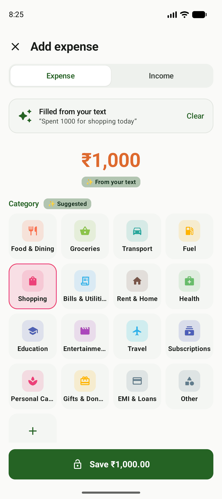
  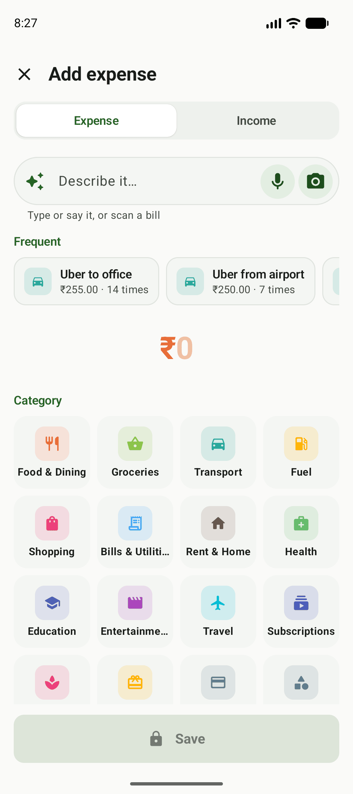
  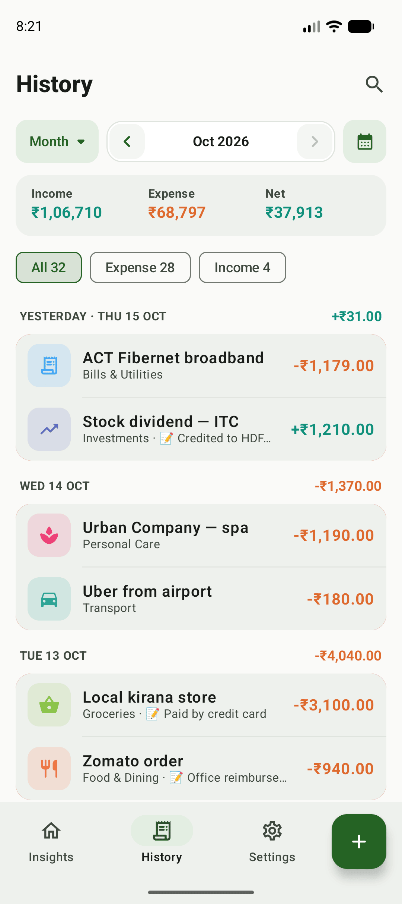
  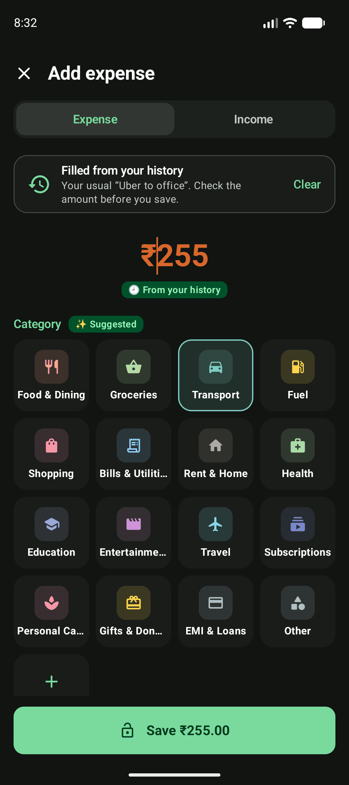
</p>

### Understand
- **Summary**: balance, income, expense and savings rate for the period, with a balance sparkline and a comparison with the same point last period.
- **Charts**, drawn on a Compose Canvas without a chart library:
  - daily or monthly spending bars with the average line; tap a bar for its total and a link to those transactions in History
  - spending pace, this period against the one before
  - net savings by month (saved or overspent)
  - where your money went: categories ranked, with the small ones folded into "Other"
- **Insights**: what you saved, your highest-spending category, and whether spending went down or up against the previous period.

### Your data
- **App lock**: fingerprint or face (whatever the phone offers as biometrics), or the phone's screen lock, locking after Immediately, 30 seconds, 1 minute or 5 minutes in the background. While the lock is on, the app's content is hidden in Recents.
- **Backup and restore**: a versioned JSON file of your transactions and categories, saved wherever you pick. A restore checks the whole file first, then replaces everything in one database transaction, so a bad file leaves your data as it was. A backup never carries the theme, profile or app lock settings, so a file can't turn the lock off. It does carry the currency code, and restoring a file made in another currency offers to switch.
- **CSV export** for a month, a year, all time or a custom range, ready for Excel or Google Sheets (UTF-8 with a BOM, plus a currency column).
- **Delete all data**, confirmed by typing `DELETE`.

<p align="center">
  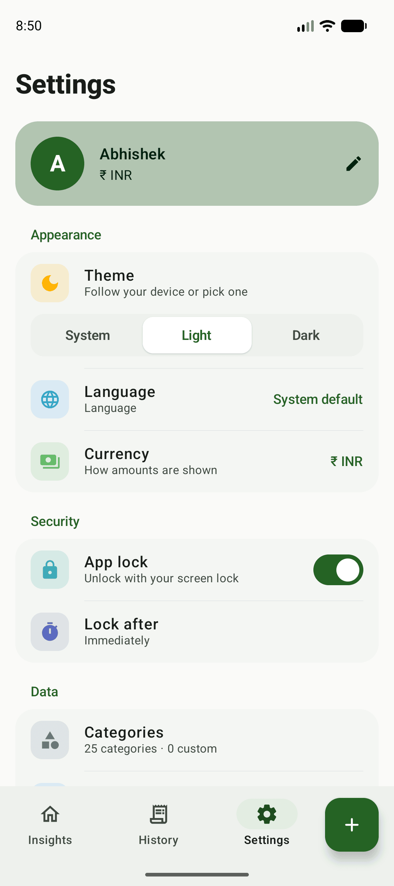
  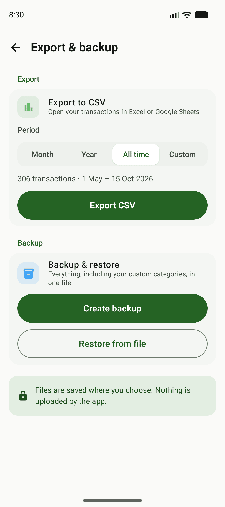
</p>

### Your way
- **6 languages**: English, Hindi, Spanish, French, German and Portuguese (Brazil), chosen inside the app (Android 13 per-app languages, AppCompat below 13). A preview shows the language before you switch, and you can undo the switch.
- **24 currencies**, as a display setting only: nothing is converted. Each currency brings its own symbol, grouping (lakh/crore for INR), decimals (none for JPY) and short units; the language decides the separators and where the symbol goes.
- **Light, dark or system theme**, switched with a circular reveal from the tapped option.
- **Respects "Remove animations"**: every animation is skipped when the phone's animator duration scale is 0.

<p align="center">
  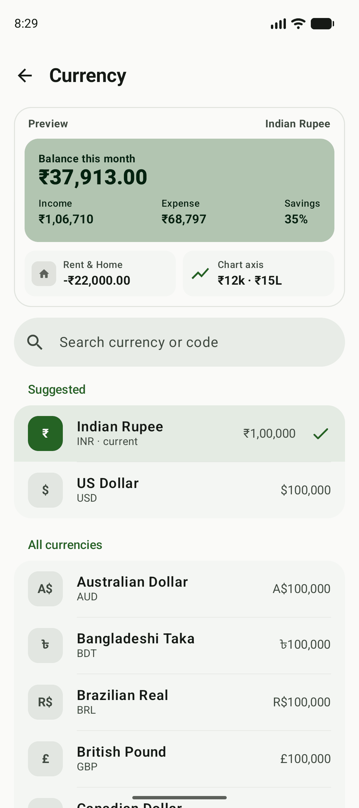
  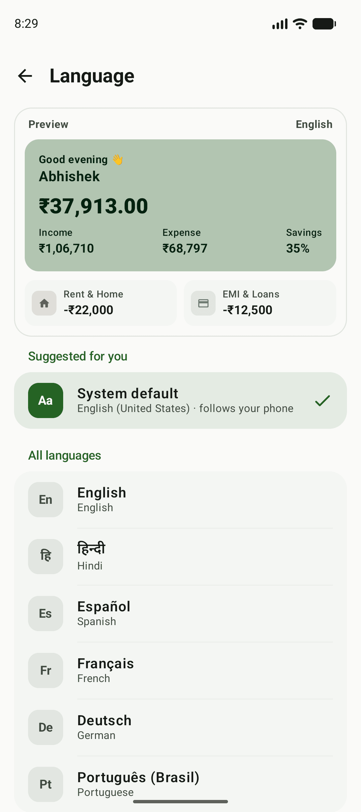
  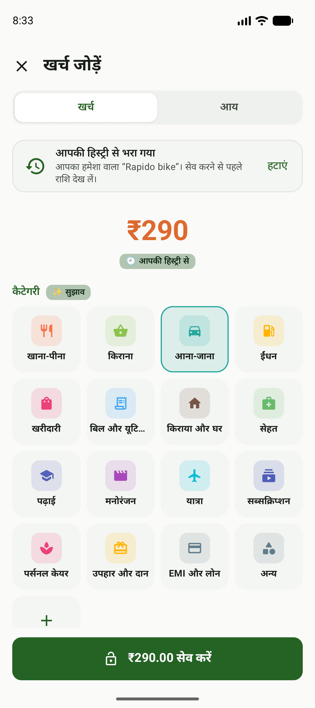
</p>

## Privacy

- **Everything stays on the phone.** Transactions and categories live in a local Room database, settings in DataStore. The app's own code makes no network calls and has no account, analytics or ads. Exports and backups go only where you save them.
- **No camera or microphone permission.** Bill photos are taken by Google's document scanner screen, and voice goes through Android's own "Speak now" screen (`RecognizerIntent`). The app only gets back the photo or the words.
- **Permissions in the merged manifest**, and where each comes from:

  | Permission | From | Why |
  |---|---|---|
  | `USE_BIOMETRIC`, `USE_FINGERPRINT` | androidx.biometric | App lock |
  | `INTERNET`, `ACCESS_NETWORK_STATE` | Google's `datatransport` library, pulled in by ML Kit | ML Kit's own logging to Google |
  | `…DYNAMIC_RECEIVER_NOT_EXPORTED_PERMISSION` | androidx.core | Keeps the app's runtime receivers private (signature-level, the app's own) |

- **Through Google Play services**: the document scanner and text recognition are the unbundled ML Kit variants. Play services downloads the recognition model when the app is installed, and the text is read on the device. ML Kit may send usage and diagnostics data to Google; see the [ML Kit terms](https://developers.google.com/ml-kit/terms).
- **Android Auto Backup** is on, with the default rules (`allowBackup="true"`), so if you've turned on Google backup, Android may include the app's data in it.

## Tech stack

| Area | Library / version |
|---|---|
| Language | Kotlin 2.0.21 |
| UI | Jetpack Compose (BOM 2024.09.00), Material 3 |
| Architecture | Clean Architecture, MVVM, unidirectional data flow |
| Dependency injection | Hilt 2.56.1 (KSP) |
| Database | Room 2.6.1 (KSP) |
| Settings | DataStore Preferences 1.1.7 |
| Async | Kotlin Coroutines 1.9.0 and Flow |
| Navigation | Navigation Compose 2.8.5 |
| Serialization (backup) | kotlinx.serialization 1.7.3 |
| App lock | androidx.biometric 1.1.0 |
| Bill scanning | ML Kit Document Scanner 16.0.0, Text Recognition v2 19.0.1 (Play services) |
| Languages | AppCompat 1.8.0 per-app locales |
| Charts | Custom Compose Canvas components (no chart library) |
| Splash | AndroidX Core SplashScreen 1.2.0 |
| Testing | JUnit 4, kotlinx-coroutines-test, Robolectric 4.14.1, hand-written fakes |
| Build | AGP 8.10.1, Gradle 8.11.1, version catalog |

**Min SDK** 24 · **Target SDK** 36

## Architecture

Three layers. Dependencies point inward: the **domain** layer is pure Kotlin and knows nothing about Android, Room or Compose.

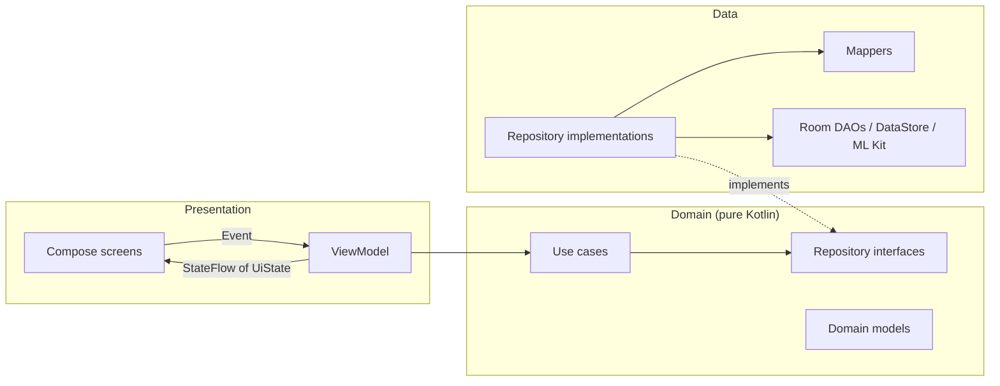

- **Presentation**: each screen has one `ViewModel` exposing a single `StateFlow<UiState>` and taking user actions as a sealed `Event`. Each screen is split into `XxxScreen` (gets the ViewModel) and a stateless `XxxContent`.
- **Domain**: one class per use case (`operator fun invoke`). Totals, savings rate, periods, insights and the quick-add and bill parsers live here.
- **Data**: Room entities are mapped to domain models and never reach the UI. Implementations are bound to their interfaces with Hilt `@Binds`.

### Every way of adding ends in a draft

Bill scanning, quick add and frequent spends all produce the same `TransactionDraft`. Only a draft reaches the form, so a new source needs no new form logic.

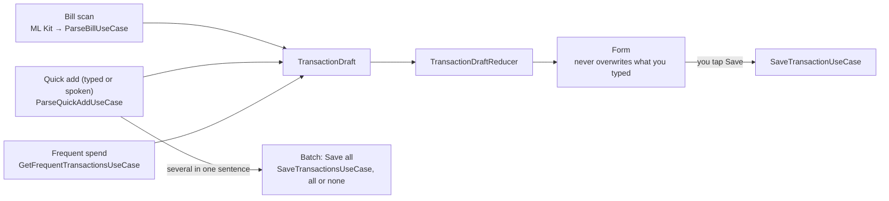

### Engineering decisions

- **Money is a `Long` of minor units** (hundredths), never `Double`, so sums don't lose cents.
- **Expected failures are `Outcome<T>` with a typed `DomainError`**, not exceptions, `Boolean` or nulls; only `SQLiteException` is caught.
- **Typed IDs** (`TransactionId`, `CategoryId` as inline value classes) can't be mixed up; Room still stores `Int`.
- **One DAO per aggregate** (transactions, categories, dashboard reads, quick-add memory, whole-app data), and each repository takes only the DAOs it uses.
- **Controllers keep ViewModels small**: app lock, backup, regional settings and draft assist are plain injectable classes, tested without a ViewModel.
- **The clock, locale and currency are injected** (`TimeProvider`, `AppLocaleProvider`, `CurrencyProvider`), so date, language and money logic is deterministic in tests.

The full reasoning is in [docs/architecture-decisions.md](docs/architecture-decisions.md).

## Testing

**1,345 unit tests** in 117 test classes, all on the JVM:

- Use cases, parsers, mappers, formatters and every ViewModel, with hand-written fakes and a fake clock.
- **Robolectric** tests against a real in-memory Room database: each DAO's queries, search, restore in one transaction, seeding after a destructive migration, and storage failures mapped to `DomainError`.
- **String resources in every language**: `StringResourcesTest` checks that each translation has exactly English's keys and format arguments, that plurals have the quantities their language needs, and that every language is offered to Android.
- **Pseudo-locales** (en-XA) are on in debug builds, for finding clipped text.

GitHub Actions runs the unit tests, lint and a debug build on every pull request and on every push to `main`.

```bash
./gradlew testDebugUnitTest lintDebug
```

## Getting started

1. Clone the repo
   ```bash
   git clone https://github.com/Abhi12Rathore/ExpenseTracker.git
   ```
2. Open it in a recent Android Studio (JDK 17).
3. Run the `app` configuration, or build from the command line:
   ```bash
   ./gradlew assembleDebug
   ```

You don't need API keys or any setup. Debug builds have **Settings → Developer → Load sample data**, to see the dashboard filled. Bill scanning needs Google Play services.

## Roadmap

**Done**
- [x] Clean Architecture with Hilt (KSP), one `UiState` + `Event` per screen
- [x] Money as integer minor units, typed IDs, `Outcome` errors
- [x] Redesigned interactive charts and insights
- [x] Biometric app lock
- [x] Backup/restore (JSON) and CSV export
- [x] Six languages, 24 display currencies
- [x] Theme reveal and cross-fade, respecting "Remove animations"
- [x] Bill scanning (ML Kit)
- [x] Quick add: typed or spoken, several in one sentence, frequent spends, learnt categories, shortcuts
- [x] CI on GitHub Actions (tests, lint, build)

**Next**
- [ ] R8 minification and shrinking for release
- [ ] Signed release build and CD
- [ ] Google Play closed testing

**Later**
- [ ] An on-device LLM behind the quick-add parser
- [ ] Quick add in Hindi script
- [ ] Import from bank SMS

## Author

**Abhishek Rathore**: Android Engineer
[GitHub](https://github.com/Abhi12Rathore)
