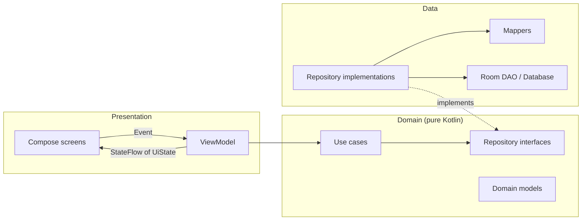

# ExpenseTracker Pro

An Android app for tracking income and expenses: log transactions, organise them into custom categories, and see where your money goes on a dashboard you can filter by week, month or year.

Built with **Kotlin** and **Jetpack Compose**, following **Clean Architecture** with **Hilt** dependency injection, and backed by unit tests.

<!-- SCREENSHOTS: add after the charts + dark mode work
<p align="center">
  
  
  
</p>
-->

---

## Features

- **Income & expense tracking**: add, edit and delete transactions with title, amount, category, date and note
- **Custom categories**: create, edit and delete categories with icons, separately for income and expense
- **Dashboard**: balance, income, expense and savings rate, with cash flow, category and monthly charts plus smart insights
- **Period filter**: Week / Month / Year with previous/next stepping (tap or swipe), or a custom date range. The same filter is used on Home and History
- **Indian currency formatting**: `₹1,00,000.00` grouping everywhere
- **Native splash screen**: Android 12+ SplashScreen API, held only while the database actually loads
- **Light & dark theme**: fixed brand palette (no wallpaper-based dynamic colour)

## Tech stack

| Area | Library |
|---|---|
| Language | Kotlin 2.0 |
| UI | Jetpack Compose, Material 3 |
| Architecture | Clean Architecture, MVVM, unidirectional data flow |
| Dependency injection | Hilt |
| Persistence | Room (KSP) |
| Async | Kotlin Coroutines & Flow |
| Navigation | Navigation Compose |
| Charts | MPAndroidChart *(migrating to Vico)* |
| Splash | AndroidX Core SplashScreen |
| Testing | JUnit 4, kotlinx-coroutines-test, hand-written fakes |

**Min SDK** 24 · **Target SDK** 35

## Architecture

The app is split into three layers. Dependencies point inward: the **domain** layer is pure Kotlin and knows nothing about Android, Room or Compose.



- **Presentation**: each screen has one `ViewModel` exposing a single `StateFlow<UiState>` and receiving user actions as a sealed `Event`. Composables are stateless (state in, lambdas out).
- **Domain**: one class per use case (`operator fun invoke`), e.g. `GetFinancialSummaryUseCase`, `StepPeriodUseCase`, `GenerateSmartInsightsUseCase`. Business rules such as totals, savings rate, date ranges and insights live here.
- **Data**: Room entities are mapped to domain models and never reach the UI. Repository implementations are bound to their interfaces with Hilt `@Binds`.
- **Time** is injected through a `TimeProvider`, so date logic (periods, month/year boundaries, greetings) is deterministic in tests.

### Project structure

```
app/src/main/java/com/example/expensetrackerpro/
├── data/           # Room entities, DAOs, mappers, repository implementations, time provider
├── di/             # Hilt modules: Database, Repository, Time
├── domain/
│   ├── models/     # Pure Kotlin models (Transaction, Category, DateFilter, DateRange, ...)
│   ├── repository/ # Repository interfaces
│   └── usecase/    # category / dashboard / filter / transaction
├── presentation/   # Screens, ViewModels, UiState & Event per feature, shared components
├── ui/theme/       # Colours, typography, theme
└── utils/          # Currency & date formatters
```

## Testing

Unit tests cover use cases, mappers, formatters and every ViewModel, using fake repositories and a fake `TimeProvider`:

- Date range and period stepping (week/month/year boundaries, year-end, custom ranges)
- Financial summary, savings rate, chart data and smart insights
- Transaction input validation and category rules
- Currency formatting with Indian digit grouping

```bash
./gradlew testDebugUnitTest
```

## Getting started

1. Clone the repo
   ```bash
   git clone https://github.com/Abhi12Rathore/ExpenseTracker.git
   ```
2. Open it in a recent Android Studio
3. Run the `app` configuration, or build from the command line:
   ```bash
   ./gradlew assembleDebug
   ```

No API keys or extra setup needed. All data is stored locally on the device.

## Roadmap

- [x] Hilt dependency injection (KSP)
- [x] Clean Architecture: domain/data layers, use cases, mappers
- [x] One `UiState` + `Event` per screen
- [x] Unit tests for use cases, mappers and ViewModels
- [x] Native splash screen with branding
- [x] Week / Month / Year period filter with custom range
- [ ] Light / Dark / System theme toggle (DataStore)
- [ ] Redesigned, interactive charts (daily spending, category ranking, spending pace, yearly savings)
- [ ] Improved add/edit transaction screen
- [ ] Biometric app lock
- [ ] Store money as integer paise instead of `Double`, with a Room migration
- [ ] CI with GitHub Actions (build, lint, tests)

## Author

**Abhishek Rathore**: Android Engineer
[GitHub](https://github.com/Abhi12Rathore)
